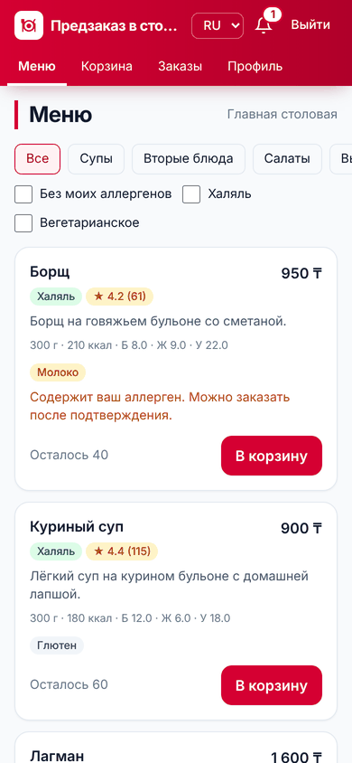
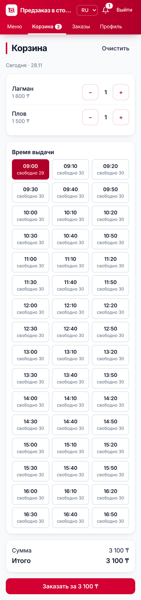
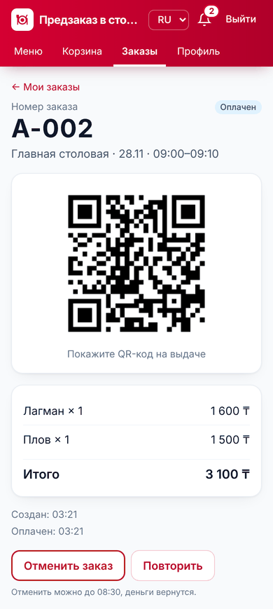
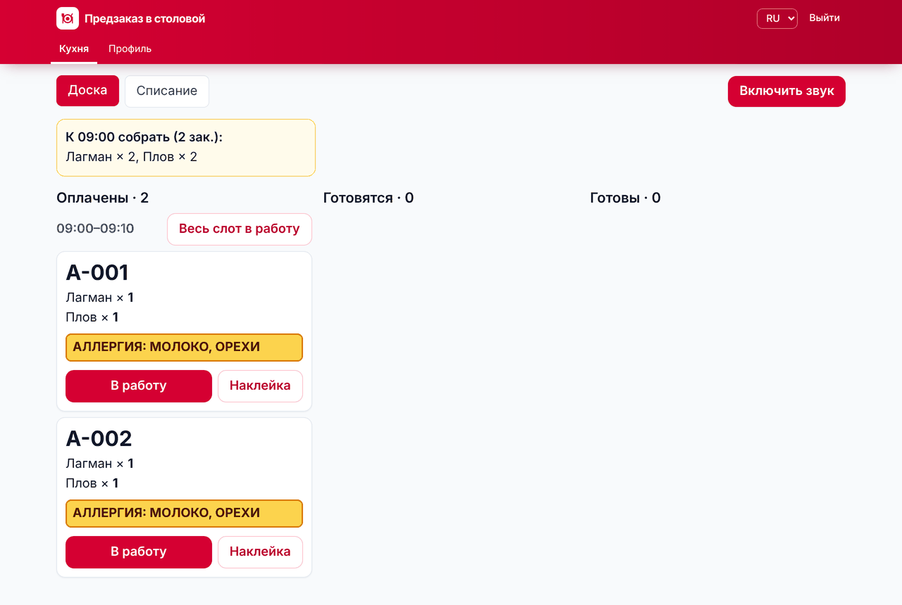
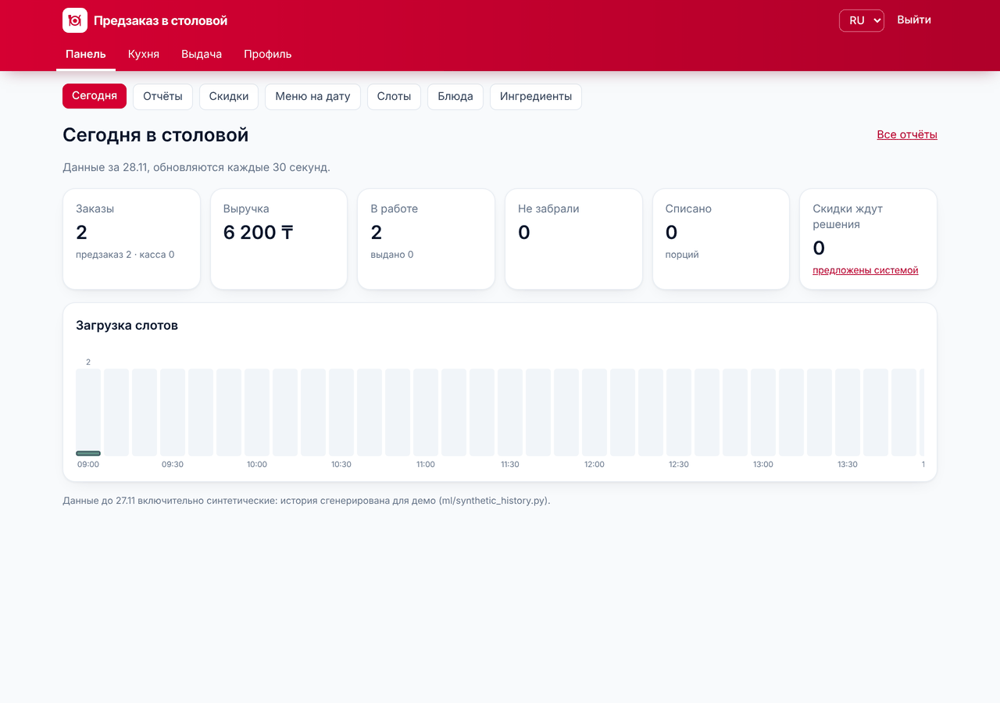
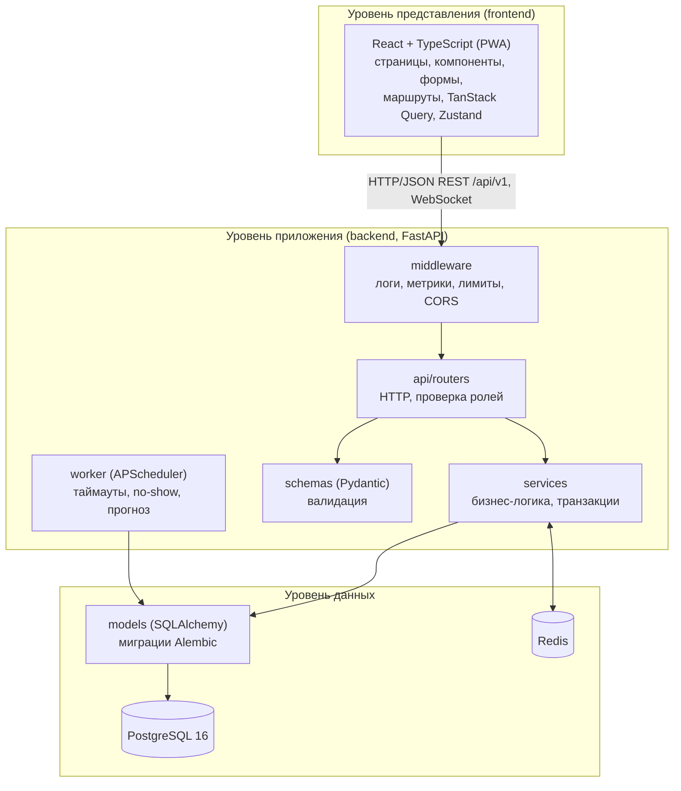

# Canteen Pre-order

Веб-приложение предзаказа в университетской столовой. Студент заказывает обед до перемены,
выбирает слот выдачи в свою перемену, оплачивает и забирает заказ по QR без очереди. Кухня
видит заказы по слотам, система прогнозирует спрос и предлагает скидки на остатки.

Финальный проект по курсу **Full Stack Development**, Университет Нархоз, Алматы, 2026.

<p>
  
  
  
</p>




Ещё скриншоты: [вход](docs/screenshots/login.png), [выдача](docs/screenshots/pickup.png),
[каталог блюд](docs/screenshots/manager-dishes.png),
[прогноз против факта](docs/screenshots/manager-forecast.png),
[скидки](docs/screenshots/manager-promotions.png), [админка](docs/screenshots/admin.png).

## Содержание

1. [Автор](#автор)
2. [Проблема и целевые пользователи](#проблема-и-целевые-пользователи)
3. [Цель и задачи](#цель-и-задачи)
4. [Требования](#требования)
5. [Роли пользователей](#роли-пользователей)
6. [Основные сценарии](#основные-сценарии)
7. [Технологии и почему они](#технологии-и-почему-они)
8. [Архитектура](#архитектура)
9. [Модули системы](#модули-системы)
10. [Модель данных](#модель-данных)
11. [API](#api)
12. [Запуск локально](#запуск-локально)
13. [Переменные окружения](#переменные-окружения)
14. [База данных: миграции и демо-данные](#база-данных-миграции-и-демо-данные)
15. [Тесты](#тесты)
16. [Адрес системы](#адрес-системы)
17. [Тестовые аккаунты](#тестовые-аккаунты)
18. [Ограничения и что улучшить](#ограничения-и-что-улучшить)
19. [Вклад автора](#вклад-автора)
20. [Документация](#документация)

## Автор

Индивидуальный проект.

| Автор | GitHub | Роль |
|---|---|---|
| Русланбек _(фамилия)_ | [@Ruslanbek970](https://github.com/Ruslanbek970) | вся система: frontend, backend, база данных, тесты, инфраструктура, документация |

## Проблема и целевые пользователи

**Проблема.** На большой перемене очередь в университетской столовой занимает до половины
перемены. Студент не успевает поесть или опаздывает на пару. Кухня готовит «на глаз»: одни
блюда заканчиваются к 12:30, другие вечером выбрасывают. Студенты с аллергиями не знают
точного состава блюд.

**Целевые пользователи:**

- студенты и преподаватели, которые хотят поесть на перемене без очереди;
- повара, которым нужен список заказов по времени выдачи;
- кассиры на выдаче;
- заведующая столовой, которая планирует меню, закупки и скидки;
- администратор университета, который ведёт пользователей, группы и расписание.

## Цель и задачи

**Цель:** разработать веб-приложение, которое позволяет заказать обед заранее, забрать его в
свою перемену без очереди и помогает столовой готовить столько, сколько купят.

**Задачи:**

1. Изучить процесс работы столовой и аналоги (есть в `docs/SPEC.md`, раздел 1).
2. Сформулировать требования и роли.
3. Спроектировать базу данных (22 таблицы, ER-диаграмма) и REST API.
4. Реализовать backend: авторизацию, роли, меню, заказы, слоты, оплату (учебную), выдачу.
5. Реализовать frontend: экраны для каждой роли, адаптив под телефон и планшет, 3 языка.
6. Сделать прогноз спроса и скидки на остатки.
7. Покрыть систему тестами: unit, API, авторизация, e2e.
8. Упаковать всё в Docker Compose и настроить CI.

## Требования

### Функциональные (требования курса F1–F8)

| ID | Требование курса | Как сделано |
|---|---|---|
| F1 | Регистрация, вход, выход | регистрация по университетской почте с кодом подтверждения, вход, выход, обновление токена (`/auth/*`, экраны «Вход» и «Регистрация») |
| F2 | Минимум две роли | 6 ролей: студент, преподаватель, повар, кассир, заведующая, администратор. Проверка на каждом эндпоинте (`require_roles`) и в маршрутах интерфейса |
| F3 | Полный CRUD главной сущности | блюда: создать, посмотреть, изменить, удалить (`/manager/dishes`). Также ингредиенты, меню дня, пользователи, столовые, группы |
| F4 | Связанные данные | заказ → позиции → позиции меню → блюда → ингредиенты → аллергены; пользователь → группа → расписание → слоты выдачи |
| F5 | Поиск, сортировка, фильтры, пагинация | у админа поиск и фильтр пользователей по роли и столовой с пагинацией; в меню фильтры по категории, халяль, вегетарианское, без моих аллергенов; отчёты по датам |
| F6 | Проверка форм на клиенте и сервере | на клиенте `required`, `type`, `min`, `pattern`; на сервере Pydantic-схемы и бизнес-правила, ответ 422 с полями |
| F7 | Состояния | загрузка, пустой список, ошибка с кнопкой «Повторить», сообщение об успехе, ошибки проверки рядом с формой |
| F8 | Администрирование | раздел «Админ»: пользователи и роли, блокировка, столовые, корпуса, группы, импорт расписания из CSV; раздел заведующей: блюда, ингредиенты, меню, скидки |

Подробные бизнес-правила: `docs/SPEC.md`, разделы 6–7.

### Нефункциональные

- **Производительность:** p95 ответа API меньше 500 мс при 500 студентах за 5 минут. Замер:
  138 мс, ни одной ошибки 5xx, ни одного переполненного слота (`docs/load-test.md`).
- **Надёжность:** списание порций и бронь слота одним атомарным `UPDATE … WHERE остаток >= :qty`,
  поэтому одновременные заказы не продают лишнего.
- **Безопасность:** пароли в bcrypt, JWT с коротким сроком жизни, роли на каждом эндпоинте,
  лимит попыток входа, секреты только в `.env`, ошибки без внутренних подробностей.
- **Удобство:** mobile-first (проверено на ширине 360 px), планшет для кухни и кассы, 3 языка
  (русский, казахский, английский), установка как приложение (PWA), меню открывается без сети.
- **Доступность:** подписи у всех полей, работа с клавиатуры, контраст, автоматическая проверка
  axe в e2e-тесте.
- **Сопровождение:** слои router → service → model, миграции Alembic, линтеры, CI на каждый push.

## Роли пользователей

| Роль | Что делает |
|---|---|
| Студент | меню, корзина, выбор слота в свою перемену, оплата, QR, история, отзывы, аллергии |
| Преподаватель | то же, что студент, но любой слот без привязки к расписанию |
| Повар | доска кухни по слотам, статусы заказов, наклейки, списания, закрытие дня |
| Кассир | выдача по QR или номеру, продажа на кассе без предзаказа |
| Заведующая | блюда и рецепты, ингредиенты, меню на дату, слоты, скидки, отчёты, прогноз |
| Администратор | пользователи и роли, столовые, корпуса, группы, импорт расписания |

## Основные сценарии

1. **Заказ студента.** Вход → меню на сегодня → блюда в корзину (предупреждение, если есть
   аллерген) → слот в свою перемену → оплата → QR и номер заказа → статус меняется в реальном
   времени.
2. **Кухня.** Повар видит заказы по слотам → «Начать» → «Готово» → печатает наклейку.
3. **Выдача.** Кассир сканирует QR или вводит номер → «Выдать». Незабранные заказы через
   30 минут сами становятся no-show.
4. **Меню и блюда (CRUD).** Заведующая создаёт блюдо с рецептом → аллергены считаются по
   ингредиентам → ставит блюдо в меню на дату → меняет цену и план → удаляет блюдо или убирает
   его из меню.
5. **Администрирование.** Админ ищет пользователя, меняет роль, блокирует, импортирует
   расписание групп из CSV.

Пошагово для показа на защите: [`docs/demo-script.md`](docs/demo-script.md).

## Технологии и почему они

| Часть | Технология | Почему |
|---|---|---|
| Backend | Python 3.12, FastAPI | быстрый, типизированный, сам строит Swagger/OpenAPI; автор знает Python (ADR 0001) |
| Проверка данных | Pydantic v2 | одна схема и проверяет запрос, и описывает API |
| Доступ к БД | SQLAlchemy 2.0, Alembic | ORM без SQL-инъекций, миграции под контролем версий |
| База | PostgreSQL 16 | транзакции, ограничения, `NUMERIC` для денег, `timestamptz` |
| Кэш и события | Redis | лимиты частоты, коды подтверждения, pub/sub для WebSocket |
| Фоновые задачи | APScheduler | таймауты оплаты, no-show, ночной прогноз без отдельного брокера |
| Прогноз | scikit-learn | градиентный бустинг против базовой модели (`docs/ml/results.md`) |
| Frontend | React, TypeScript, Vite | компоненты, строгие типы, быстрая сборка |
| Данные на клиенте | TanStack Query, Zustand | кэш запросов и обновление после изменений; простое хранилище для токенов и корзины |
| Стили | Tailwind | адаптивная вёрстка без отдельных CSS-файлов |
| Языки | i18next | русский, казахский, английский |
| Инфраструктура | Docker Compose, nginx | вся система поднимается одной командой на любом компьютере |
| CI | GitHub Actions | линтеры, тесты, сборка образов и e2e на каждый push |
| Мониторинг | Prometheus, Grafana | метрики и дашборд нагрузки |

Решения подробнее: [`docs/adr/`](docs/adr/README.md).

## Архитектура

Трёхуровневая архитектура: интерфейс, сервер приложения, данные.



Схема всех контейнеров (nginx, worker, bot, мониторинг), поток заказа и диаграмма статусов:
[`docs/architecture.md`](docs/architecture.md).

## Модули системы

| Модуль | Backend | Frontend |
|---|---|---|
| Авторизация | `routers/auth.py`, `services/auth.py`, `security.py` (bcrypt, JWT) | `features/auth` |
| Профиль и аллергии | `routers/me.py`, `services/users.py`, `services/allergens.py` | `features/profile` |
| Меню и каталог | `routers/menu.py`, `routers/manager_catalog.py`, `services/catalog.py`, `services/menu.py` | `features/menu`, `features/manager` |
| Слоты выдачи | `routers/slots.py`, `services/slots.py` | `features/checkout` |
| Заказы и статусы | `routers/orders.py`, `services/orders.py`, `services/order_status.py` | `features/cart`, `features/orders` |
| Оплата (учебная) | `routers/payments.py`, `payments/` | `features/orders` |
| Кухня | `routers/kitchen.py`, `services/kitchen.py`, `ws/` | `features/kitchen` |
| Выдача и касса | `routers/pickup.py`, `services/pickup.py` | `features/pickup`, `features/pos` |
| Скидки, отчёты, прогноз | `routers/promotions.py`, `routers/reports.py`, `ml/` | `features/manager` |
| Администрирование | `routers/admin.py`, `services/admin.py` | `features/admin` |
| Уведомления | `notifications/`, `bot/` (Telegram) | `features/notifications` |
| Общее | `errors.py` (единый формат ошибок), `middleware.py`, `config.py`, `db.py` | `api/client.ts` (один адрес API), `components/ui` |

## Модель данных

- ER-диаграмма: [`docs/er_diagram.png`](docs/er_diagram.png)
- Эталонная схема: [`docs/schema.sql`](docs/schema.sql) (22 таблицы, первичные и внешние
  ключи, `UNIQUE`, `CHECK`, индексы, триггеры журнала статусов)
- Модели: `backend/app/models/`, миграции: `backend/alembic/versions/`

Главные связи: `users → student_groups → class_schedule`, `canteens → menu_items → dishes →
dish_ingredients → ingredients → allergens`, `orders → order_items → menu_items`,
`orders → pickup_slots`, `orders → payments`, `order_items → dish_reviews`.

## API

- REST, префикс `/api/v1`, JSON. Методы GET, POST, PUT, PATCH, DELETE.
- Swagger (OpenAPI) при запущенной системе: http://localhost:8000/api/docs
- Описание сценариев и список всех эндпоинтов: [`docs/api.md`](docs/api.md)
- Все ошибки в одном формате, включая 500 (без трассировки):

```json
{ "error": { "code": "slot_full", "message": "В этом слоте нет мест", "details": {} } }
```

## Запуск локально

Нужен [Docker Desktop](https://www.docker.com/products/docker-desktop/) (Windows, macOS) или
Docker с Compose (Linux). Docker Desktop должен быть запущен («Engine running»).

**Windows (PowerShell) или любая система без `make`:**

```powershell
git clone https://github.com/Ruslanbek970/canteen-preorder.git
cd canteen-preorder
copy .env.example .env        # в Linux/macOS: cp .env.example .env
docker compose up -d --build
```

**С `make` (Linux, macOS):** `make dev`.

При первом запуске backend сам применяет миграции и загружает демо-данные. Через минуту:

| Что | Адрес |
|---|---|
| Приложение | http://localhost:5173 |
| Swagger | http://localhost:8000/api/docs |
| Mailpit (письма с кодами) | http://localhost:8025 |
| Grafana (по желанию) | http://localhost:3000, admin/admin |

Grafana и Prometheus: `docker compose --profile monitoring up -d prometheus grafana`.

Остановить: `docker compose down`. Обновиться: `git pull`, потом `docker compose up -d --build`.
После обновления интерфейса в браузере нажмите Ctrl+F5.

## Переменные окружения

Файл `.env` создаётся из `.env.example` и в git не попадает. Все настройки читает
`backend/app/config.py`.

| Переменная | Пример | Зачем |
|---|---|---|
| `APP_ENV` | `dev` | `dev`, `test` или `prod` |
| `TZ` | `Asia/Almaty` | часовой пояс («сегодня» считается по Алматы) |
| `DATABASE_URL` | `postgresql+psycopg://canteen:canteen@db:5432/canteen` | подключение к PostgreSQL (логин и пароль базы) |
| `DB_POOL_SIZE`, `DB_MAX_OVERFLOW` | `10`, `10` | размер пула соединений |
| `REDIS_URL` | `redis://redis:6379/0` | подключение к Redis |
| `JWT_SECRET` | пусто | ключ подписи токенов; в dev создаётся сам, в prod обязателен |
| `ACCESS_TOKEN_MINUTES`, `REFRESH_TOKEN_DAYS` | `15`, `30` | срок жизни токенов |
| `ALLOWED_EMAIL_DOMAINS` | `demo.kz,uni.kz` | с каких почт можно регистрироваться |
| `FRONTEND_URL` | `http://localhost:5173` | адрес сайта для ссылок в письмах и CORS |
| `SMTP_HOST`, `SMTP_PORT`, `SMTP_FROM` | `mailpit`, `1025` | отправка писем (локально в Mailpit) |
| `TELEGRAM_BOT_TOKEN`, `TELEGRAM_BOT_USERNAME` | пусто | Telegram-бот; без токена бот просто ждёт |
| `VAPID_PUBLIC_KEY`, `VAPID_PRIVATE_KEY` | пусто | Web Push; ключи: `docker compose exec backend python -m scripts.generate_vapid_keys` |
| `PAYMENT_PROVIDER` | `mock` | только учебная оплата |
| `UNPAID_ORDER_TIMEOUT_MINUTES` | `10` | через сколько отменять неоплаченный заказ |
| `NO_SHOW_AFTER_MINUTES` | `30` | через сколько после слота заказ считается незабранным |
| `SENTRY_DSN` | пусто | отправка ошибок в Sentry (по желанию) |

## База данных: миграции и демо-данные

Всё применяется само при старте backend. Вручную:

```powershell
docker compose exec backend alembic upgrade head        # миграции
docker compose exec backend python -m scripts.seed      # пересоздать демо-данные
```

Подключиться к базе своим клиентом (pgAdmin, DBeaver): host `localhost`, port `5432`,
база, логин и пароль `canteen` / `canteen` / `canteen` (локальные демо-значения из `.env.example`).

## Тесты

| Вид | Что проверяет | Где |
|---|---|---|
| Unit | расчёт цен и скидок, аллергены, переходы статусов, время Алматы, корзина, форматирование | `backend/tests`, `frontend/tests` |
| Интеграционные / API | эндпоинты с настоящей PostgreSQL и Redis: заказы, слоты, оплата, кухня, выдача, CRUD блюд | `backend/tests` |
| Авторизация | регистрация, подтверждение почты, вход, выход, обновление токена, доступ по ролям | `backend/tests/test_auth.py`, `test_roles.py` |
| E2E | студент заказывает → повар готовит → кассир выдаёт; проверка доступности | `frontend/e2e` (Playwright) |
| Нагрузка | 500 студентов в перемену | `infra/k6`, `docs/load-test.md` |

Команды (система запущена через `docker compose up -d`):

```powershell
# backend: линтер и тесты
docker compose exec backend ruff check .
docker compose exec backend pytest --cov=app

# frontend: линтер, типы, тесты
docker compose exec frontend npm run lint
docker compose exec frontend npm run typecheck
docker compose exec frontend npm test

# e2e (нужен Node.js 20+ на компьютере)
cd frontend
npm ci
npx playwright install chromium
npm run e2e
```

С `make`: `make test`, `make lint`, `make e2e`.

Последние результаты: [`docs/test-results.md`](docs/test-results.md). Те же проверки
запускаются в GitHub Actions на каждый push (вкладка Actions).

## Адрес системы

Production URL: **развёртывание локальное** (требование курса 5.8). После запуска система
доступна на http://localhost:5173, API на http://localhost:8000/api/v1.

Для сервера всё готово (`docker-compose.prod.yml`, HTTPS, автодеплой из GitHub Actions), шаги в
[`docs/deployment.md`](docs/deployment.md).

## Тестовые аккаунты

Пароль у всех `demo1234`. Это вымышленные демо-данные, реальных персональных данных нет.

| Роль | Почта | Что смотреть |
|---|---|---|
| Студент | `student@demo.kz` | меню, аллергии (орехи — тяжёлая, молоко — лёгкая), заказ, QR |
| Преподаватель | `teacher@demo.kz` | заказ в любой слот, без расписания |
| Повар | `cook@demo.kz` | доска кухни, наклейки, списания |
| Кассир | `cashier@demo.kz` | выдача по QR или номеру, касса |
| Заведующая | `manager@demo.kz` | сегодня, блюда (CRUD), меню, скидки, отчёты, прогноз |
| Администратор | `admin@demo.kz` | пользователи, столовые, группы, расписание |

Код подтверждения почты при регистрации приходит в Mailpit: http://localhost:8025.

## Ограничения и что улучшить

- Оплата учебная (`MockPaymentProvider`). Следующий шаг: подключить Kaspi или банк.
- Система развёрнута локально. Для пилота нужен сервер и домен (`docs/deployment.md`).
- Прогноз обучен на синтетической истории за 8 недель. На реальных данных его надо переобучить.
- Telegram-бот и Web Push работают только после того, как в `.env` добавлены токен и ключи.
- Блюдо, которое уже было в меню, нельзя удалить (иначе потеряется история заказов и отчёты).
  Его можно выключить.
- Одна база на все столовые. При росте можно вынести прогноз и уведомления в отдельные сервисы.
- Идеи на будущее: доставка по кампусу, лояльность с баллами в кассе, нативное приложение.

## Вклад автора

Проект выполнен одним студентом, все части сделаны автором:

| Часть | Что сделано | Где |
|---|---|---|
| Требования и проектирование | ТЗ, роли, сценарии, схема БД, архитектура, ADR | `docs/SPEC.md`, `docs/schema.sql`, `docs/architecture.md`, `docs/adr/` |
| Backend | модели и миграции, авторизация и роли, меню, слоты, заказы, оплата, кухня, выдача, отчёты, админка, единый формат ошибок | `backend/app/` |
| Frontend | экраны всех ролей, формы с проверкой, состояния загрузки и ошибок, 3 языка, PWA, дизайн в цветах Нархоза | `frontend/src/` |
| Прогноз спроса | синтетическая история, две модели, сравнение точности | `backend/ml/`, `docs/ml/results.md` |
| Тесты | unit, API, авторизация, e2e, нагрузка | `backend/tests/`, `frontend/tests/`, `frontend/e2e/`, `infra/k6/` |
| Инфраструктура | Docker Compose, nginx, CI в GitHub Actions, мониторинг | `docker-compose*.yml`, `.github/workflows/`, `infra/` |

Код писался с помощью ИИ-ассистента Claude Code по правилам из [`CLAUDE.md`](CLAUDE.md):
автор ставил задачи по фазам ТЗ, проверял результат и запускал систему. История работы по фазам
в [`docs/PROGRESS.md`](docs/PROGRESS.md), изменения через ветки и pull request (вкладка
Pull requests).

## Документация

| Документ | О чём |
|---|---|
| [`docs/SPEC.md`](docs/SPEC.md) | техническое задание |
| [`docs/architecture.md`](docs/architecture.md) | компоненты, поток заказа, слои, статусы |
| [`docs/api.md`](docs/api.md) | главные сценарии API и список эндпоинтов |
| [`docs/user-guide.md`](docs/user-guide.md) | инструкции для студента, повара, кассира, заведующей, админа |
| [`docs/test-results.md`](docs/test-results.md) | результаты тестов |
| [`docs/deployment.md`](docs/deployment.md) | сервер, TLS, автодеплой, мониторинг, бэкапы |
| [`docs/load-test.md`](docs/load-test.md) | нагрузочный тест и результаты |
| [`docs/ml/results.md`](docs/ml/results.md) | прогноз спроса: модели и точность |
| [`docs/adr/`](docs/adr/README.md) | решения: FastAPI, атомарные UPDATE, PWA, mock-оплата |
| [`docs/demo-script.md`](docs/demo-script.md) | сценарий показа на защите |
| [`docs/schema.sql`](docs/schema.sql), [`docs/er_diagram.png`](docs/er_diagram.png) | схема базы |
| [`docs/PROGRESS.md`](docs/PROGRESS.md) | журнал работ по фазам и решения |
| [`CLAUDE.md`](CLAUDE.md) | правила разработки |

## Разработка без Docker

```bash
# backend (нужны PostgreSQL и Redis, адреса в .env)
cd backend
python3.12 -m venv .venv && . .venv/bin/activate
pip install -e ".[dev]"
ruff check . && ruff format --check . && pytest

# frontend
cd frontend
npm ci
npm run lint && npm run typecheck && npm test
npm run dev     # http://localhost:5173, /api проксируется на localhost:8000
```

Pre-commit хуки (ruff, eslint, prettier): `pip install pre-commit && pre-commit install`.
