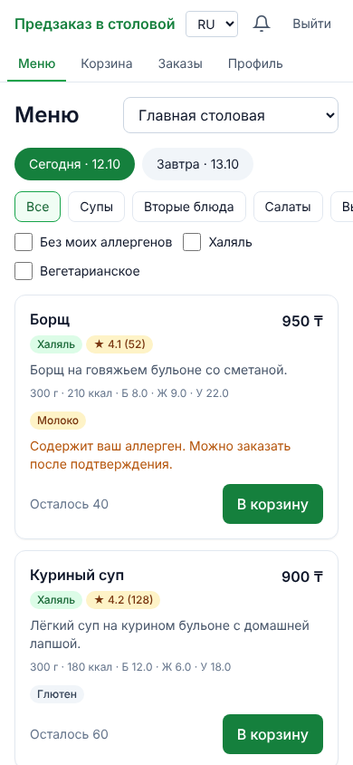
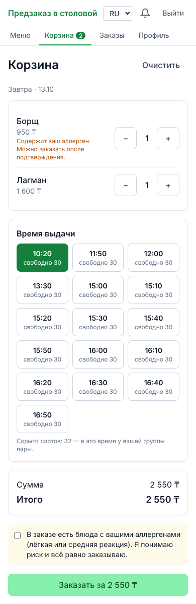
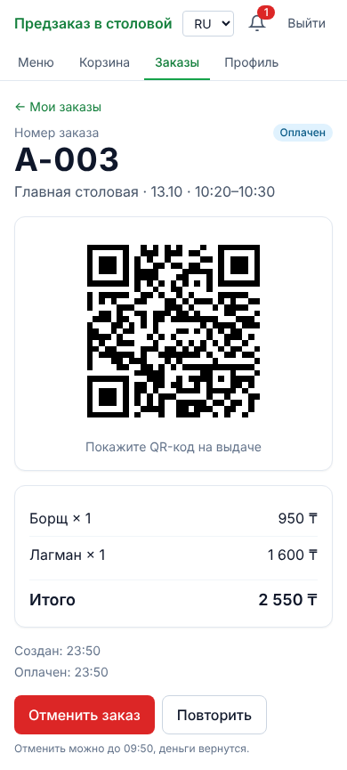
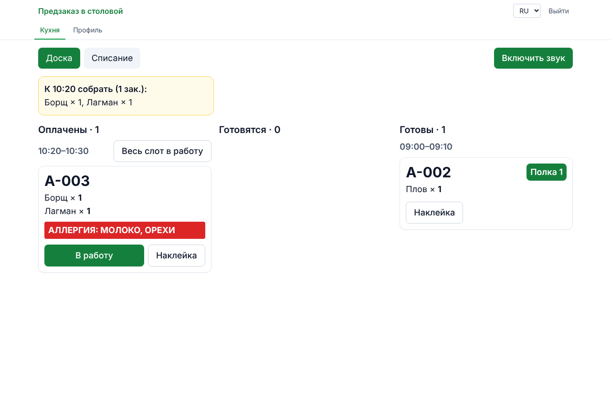
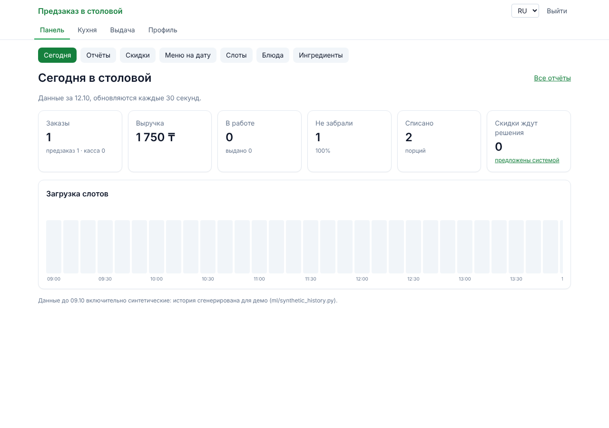

# Canteen Pre-order

Веб-приложение предзаказа в университетской столовой. Студент заказывает обед до перемены,
выбирает слот выдачи в свою перемену, оплачивает и забирает заказ по QR без очереди. Кухня
видит заказы по слотам, система прогнозирует спрос и предлагает скидки на остатки.
Дипломный проект.

<p>
  
  
  
</p>




Ещё скриншоты: [выдача](docs/screenshots/pickup.png),
[прогноз против факта](docs/screenshots/manager-forecast.png),
[скидки](docs/screenshots/manager-promotions.png).

## Запуск за 3 команды

Нужен Docker Desktop (Windows, macOS) или Docker с Compose (Linux).

```bash
git clone https://github.com/Ruslanbek970/canteen-preorder.git
cd canteen-preorder
make dev
```

Без `make` (например, в PowerShell) третья команда: `cp .env.example .env` и
`docker compose up -d --build`.

При первом запуске backend сам применяет миграции и загружает демо-данные. Через минуту:

| Что | Адрес |
|---|---|
| Приложение | http://localhost:5173 |
| Swagger | http://localhost:8000/api/docs |
| Mailpit (письма с кодами) | http://localhost:8025 |

Обновиться до новой версии: `git pull`, потом `docker compose up -d --build`.

## Демо-аккаунты

Пароль у всех `demo1234`.

| Роль | Почта | Что смотреть |
|---|---|---|
| Студент | `student@demo.kz` | меню, аллергии (орехи — тяжёлая, молоко — лёгкая), заказ, QR |
| Преподаватель | `teacher@demo.kz` | заказ в любой слот, без расписания |
| Повар | `cook@demo.kz` | доска кухни, наклейки, списания |
| Кассир | `cashier@demo.kz` | выдача по QR или номеру, касса |
| Заведующая | `manager@demo.kz` | сегодня, меню, скидки, отчёты, прогноз |
| Администратор | `admin@demo.kz` | пользователи, столовые, группы, расписание |

## Что умеет

- Меню на сегодня и завтра, КБЖУ, отзывы, фильтры; отметки аллергенов по ингредиентам.
- Слоты выдачи только в перемены группы студента, атомарное бронирование мест и порций.
- Учебная оплата, QR и номер заказа, статусы в реальном времени (WebSocket), уведомления в
  приложении, по e-mail, Web Push и в Telegram.
- Кухня: доска по слотам, «собрать к ближайшим слотам», наклейки, списания, закрытие дня.
- Касса: выдача по QR или номеру, продажа без предзаказа.
- Заведующая: показатели дня, меню на дату, скидки на остатки и тихие слоты, отчёты с CSV,
  прогноз спроса (две модели, выбор по ошибке).
- Админ: пользователи и роли, столовые, корпуса, группы, импорт расписания из CSV.
- PWA: установка на телефон, меню без сети. Интерфейс на русском, казахском и английском.

## Стек

- Backend: Python 3.12, FastAPI, Pydantic v2, SQLAlchemy 2.0, Alembic, PostgreSQL 16, Redis,
  APScheduler, aiogram 3, scikit-learn.
- Frontend: React + TypeScript + Vite, React Router, TanStack Query, Zustand, Tailwind,
  i18next.
- Инфраструктура: Docker Compose, nginx, GitHub Actions (CI и деплой), Prometheus, Grafana,
  Alertmanager, k6.

## Команды

```bash
make dev          # поднять всё локально
make down         # остановить
make logs         # логи
make migrate      # миграции
make seed         # пересоздать демо-данные
make test         # тесты backend и frontend
make lint         # ruff, eslint, tsc, prettier
make format       # автоформатирование
make e2e          # Playwright: студент → кухня → касса (при запущенном make dev)
make load-test    # k6: 500 студентов в перемену
make monitoring   # Prometheus :9090 и Grafana :3000
make backup       # дамп базы
make restore FILE=...   # восстановление в тестовую базу
```

## Документация

| Документ | О чём |
|---|---|
| [`docs/SPEC.md`](docs/SPEC.md) | техническое задание |
| [`docs/architecture.md`](docs/architecture.md) | компоненты, поток заказа, слои, статусы |
| [`docs/api.md`](docs/api.md) | главные сценарии API и список эндпоинтов |
| [`docs/user-guide.md`](docs/user-guide.md) | инструкции для студента, повара, кассира, заведующей, админа |
| [`docs/deployment.md`](docs/deployment.md) | сервер, TLS, автодеплой, мониторинг, бэкапы |
| [`docs/load-test.md`](docs/load-test.md) | нагрузочный тест и результаты |
| [`docs/ml/results.md`](docs/ml/results.md) | прогноз спроса: модели и точность |
| [`docs/adr/`](docs/adr/README.md) | решения: FastAPI, атомарные UPDATE, PWA, mock-оплата |
| [`docs/demo-script.md`](docs/demo-script.md) | сценарий показа на защите |
| [`docs/schema.sql`](docs/schema.sql), [`docs/er_diagram.png`](docs/er_diagram.png) | схема базы |
| [`docs/PROGRESS.md`](docs/PROGRESS.md) | журнал работ по фазам и решения |
| [`CLAUDE.md`](CLAUDE.md) | правила разработки |

## Разработка без Docker

```bash
# backend (нужны PostgreSQL и Redis, адреса в .env)
cd backend
python3.12 -m venv .venv && . .venv/bin/activate
pip install -e ".[dev]"
ruff check . && ruff format --check . && pytest

# frontend
cd frontend
npm ci
npm run lint && npm run typecheck && npm test
npm run dev     # http://localhost:5173, /api проксируется на localhost:8000
```

Pre-commit хуки (ruff, eslint, prettier): `pip install pre-commit && pre-commit install`.
