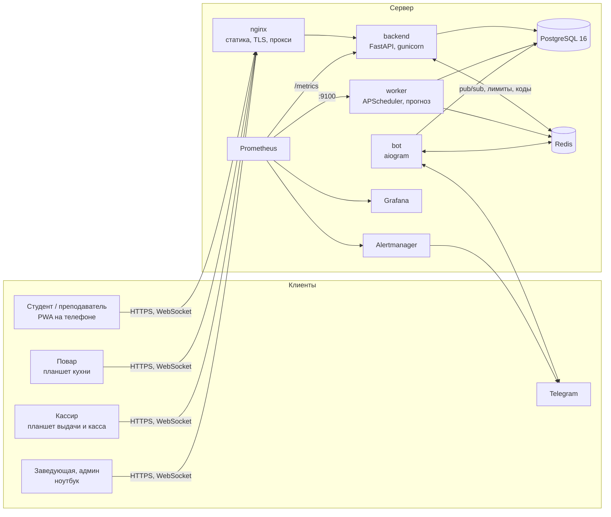
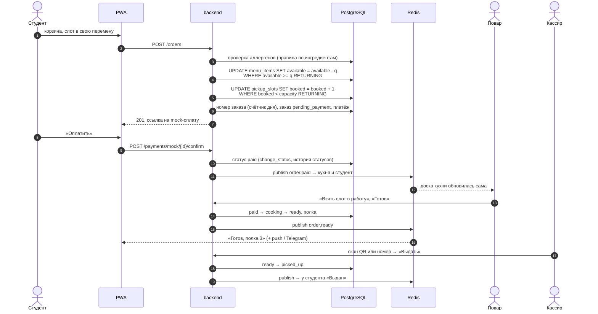
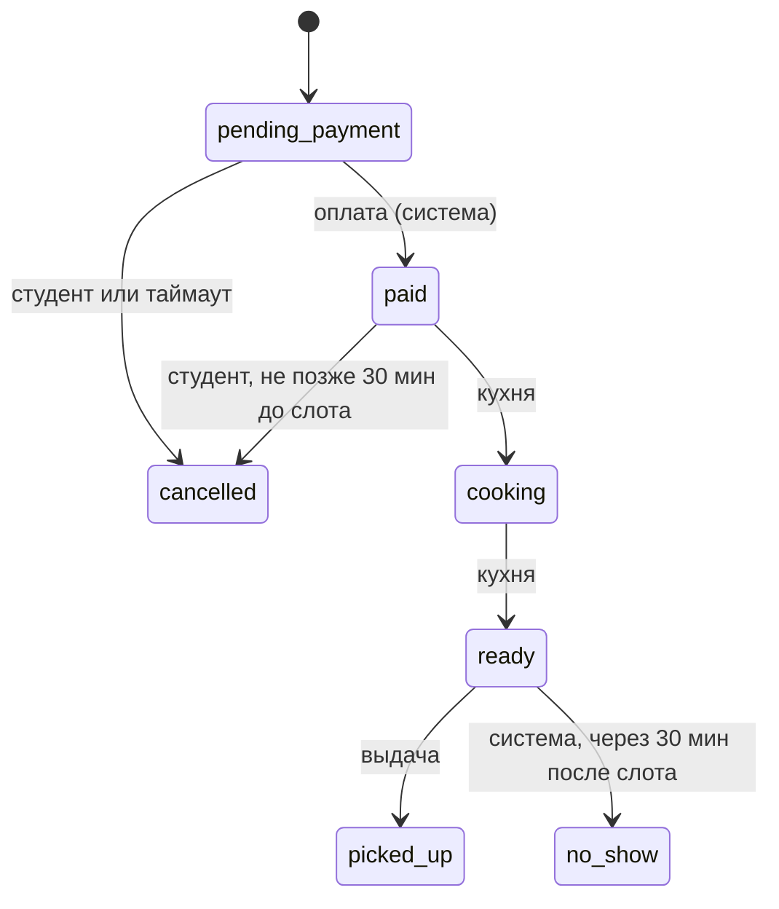

# Архитектура

## Компоненты



- **backend**: REST API `/api/v1` и WebSocket `/ws/me` (статусы заказов студента) и
  `/ws/kitchen/{id}` (доска кухни).
- **worker**: фоновые задачи (SPEC 10):
  - слоты на день;
  - отмена неоплаченных заказов и неявки;
  - напоминания;
  - скидки на остатки и в тихие слоты;
  - доставка Web Push;
  - ночной прогноз спроса.

  Ещё worker отдаёт бизнес-метрики.
- **bot**: Telegram-бот (привязка аккаунта, `/orders`, уведомления из очереди в Redis).
- **Redis**:
  - pub/sub для WebSocket между процессами;
  - лимиты частоты;
  - коды подтверждения почты;
  - очередь сообщений бота.
- **PostgreSQL**: все данные. Триггер пишет историю статусов заказа, остатки и места меняются
  атомарными `UPDATE`.
- **Frontend**: React + TypeScript (Vite), PWA с service worker (офлайн-меню, Web Push). Тексты
  на ru, kk и en.

## Слои backend

```
app/api/routers/*   HTTP: схемы запроса и ответа, require_roles(...), никакой логики
      │
app/services/*      бизнес-логика и транзакции; ошибки — DomainError(code, message)
      │
app/models/*        SQLAlchemy 2.0 модели; схема меняется только миграциями Alembic
```

Основные модули:

| Модуль | Что делает |
|---|---|
| `services/orders.py` | создание заказа, порции, отмена, повтор, автоотмена неоплаченных |
| `services/order_status.py` | единственное место смены статуса: таблица разрешённых переходов (SPEC 7.6) |
| `services/slots.py` | генерация слотов, фильтр по расписанию группы, атомарное бронирование |
| `services/allergens.py` | правила по ингредиентам: `severe` запрещает, `mild` требует подтверждения |
| `services/pricing.py`, `promotions.py` | скидки на остатки и в тихие слоты, итоговая сумма в `Decimal` |
| `payments/` | `PaymentProvider` и `MockPaymentProvider` (реальных платёжных систем нет) |
| `services/kitchen.py`, `pickup.py` | доска кухни по слотам, наклейки, списания; выдача по QR и номеру, касса |
| `services/reports.py`, `forecast_report.py` | отчёты заведующей и CSV |
| `ml/forecast.py` | прогноз спроса: `baseline_avg` и `gbm_v1`, выбор по MAE на бэктесте |
| `notifications/` | уведомления: в приложении, e-mail, Web Push, Telegram |
| `ws/events.py` | события копятся в сессии БД и публикуются в Redis только после commit |
| `metrics.py`, `logs.py`, `middleware.py` | Prometheus, JSON-логи, `request_id` |

## Поток заказа



Если оплата не пришла за 10 минут, worker отменяет заказ и возвращает порции и место. Если
заказ не забрали через 30 минут после конца слота, он становится `no_show`.

## Статусы заказа



Любой другой переход даёт 409 `invalid_transition`. Перед сменой статуса выполняется
`SET LOCAL app.current_user_id`, и триггер записывает в `order_status_history`, кто это сделал.

## Конкурентность

Порции и места меняются только одним SQL-запросом с условием и `RETURNING` (SPEC 5.3). Если
строка не обновилась, значит, места или порции кончились, и заказ получает 409. Транзакция
откатывается целиком: ничего не списано наполовину. Тесты с потоками проверяют, что 50
параллельных заказов на 30 мест дают ровно 30 успешных, а последнюю порцию получает один заказ
из двух. Нагрузочный тест подтверждает это под 500 пользователями (`docs/load-test.md`).
Почему так, а не блокировки в Redis — `docs/adr/0002-atomic-updates.md`.

## Данные и приватность

- Деньги хранятся в `NUMERIC(10,2)`, в Python это `Decimal`. Время хранится в `timestamptz`,
  «сегодня» считается в `Asia/Almaty`.
- Аллергии видит только сам пользователь (с отдельным согласием на обработку данных о
  здоровье). Кухня видит только строку «АЛЛЕРГИЯ: ...» в заказе. В админке и отчётах данных о
  здоровье нет. Кэш меню с отметками аллергенов удаляется из браузера при выходе.
- Решение «можно ли блюдо при аллергии» принимают только правила по ингредиентам, без ИИ.

## Схема базы

`docs/schema.sql` (эталон) и `docs/er_diagram.png`. В приложении схема создаётся миграциями
`backend/alembic/versions/`.
