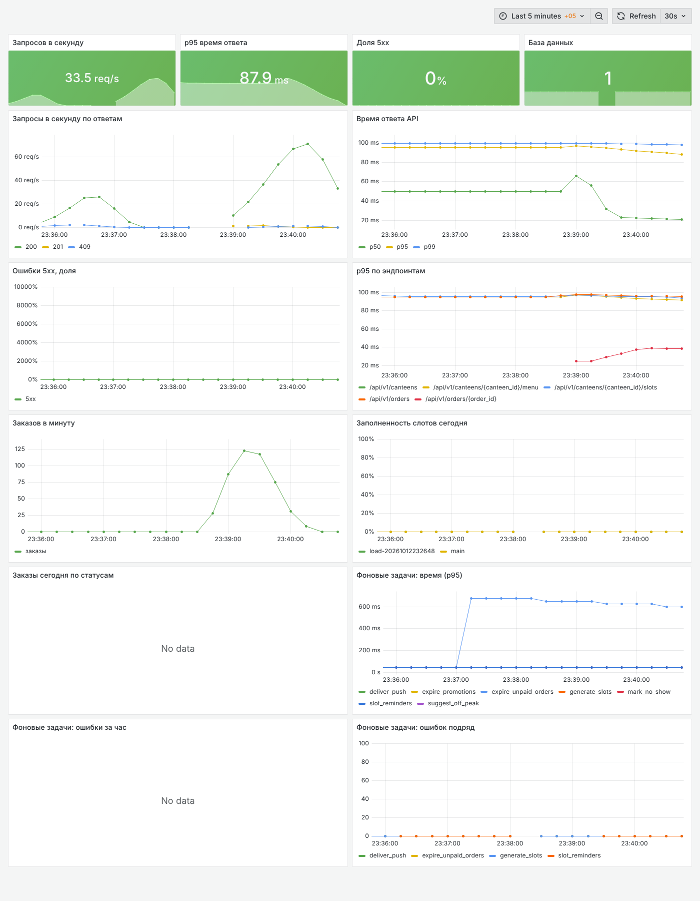

# Развёртывание

Как устроен продакшен, как поднять сервер с нуля, как работают автодеплой, мониторинг и
бэкапы (SPEC 14).

## Схема

```
интернет ──► nginx (80/443, Let's Encrypt) ──► статика фронтенда (PWA)
                     │                     ├─► /api, /ws ──► backend (gunicorn + uvicorn, 3 процесса)
                     │                     └─► /grafana  ──► grafana ──► prometheus
                     │
 backend, worker, bot ──► postgres 16 (том db_data) и redis 7 (том redis_data)
 prometheus ──► backend:8000/metrics, worker:9100 ──► alertmanager ──► Telegram
 backup ──► pg_dump каждый день в 03:00 в том backups, хранение 14 дней
```

Файлы: `docker-compose.prod.yml`, `.env.prod.example`, `infra/nginx/`, `infra/prometheus/`,
`infra/alertmanager/`, `infra/grafana/`, `infra/backup/`, `infra/deploy.sh`,
`.github/workflows/deploy.yml`, `backend/gunicorn.conf.py`.

Образы собирает GitHub Actions и кладёт в GHCR:
`ghcr.io/ruslanbek970/canteen-preorder-backend` (backend, worker и bot — один образ с разными
командами) и `ghcr.io/ruslanbek970/canteen-preorder-frontend` (nginx со сборкой фронтенда).
Теги — SHA коммита и `latest`.

## Первый запуск сервера

Нужно: VPS с Ubuntu 22.04/24.04 (2 CPU, 4 ГБ RAM, 30 ГБ диска; лучше в Казахстане),
домен с A-записью на IP сервера, открытые порты 22, 80, 443.

1. Docker на сервере:
   ```
   curl -fsSL https://get.docker.com | sh
   sudo usermod -aG docker $USER     # перелогиниться
   ```
2. Ключ для деплоя (на своём компьютере):
   ```
   ssh-keygen -t ed25519 -f canteen_deploy -N ""
   ssh-copy-id -i canteen_deploy.pub user@SERVER_IP
   ```
3. `.env`: скопировать `.env.prod.example`, заполнить. Обязательно:
   - `DOMAIN`, `ACME_EMAIL` (почта для Let's Encrypt);
   - `POSTGRES_PASSWORD` и тот же пароль в `DATABASE_URL`;
   - `JWT_SECRET` (`openssl rand -hex 32`), `GRAFANA_ADMIN_PASSWORD`;
   - `FRONTEND_URL=https://<домен>`, `ALLOWED_EMAIL_DOMAINS` (домены почты университета);
   - SMTP для писем с кодом подтверждения.

   По желанию: `TELEGRAM_BOT_TOKEN`, `ALERT_TELEGRAM_CHAT_ID` (чат для алертов), ключи Web Push.
4. Секреты в GitHub: Settings → Secrets and variables → Actions:

   | Секрет | Значение |
   |---|---|
   | `SSH_HOST` | IP или домен сервера |
   | `SSH_USER` | пользователь на сервере (в группе docker) |
   | `SSH_KEY` | содержимое приватного ключа `canteen_deploy` |
   | `PROD_ENV` | весь заполненный `.env` |
   | `DEPLOY_PATH` | необязательно, папка на сервере (по умолчанию `~/canteen`) |

   Токен для GHCR отдельно не нужен: деплой использует `GITHUB_TOKEN` своего запуска.
5. Запустить workflow **Deploy** вручную (Actions → Deploy → Run workflow) или сделать push в
   `main`. Сайт откроется сначала по `http://<домен>`, а через несколько минут, когда certbot
   получит сертификат, nginx сам перейдёт на HTTPS.
6. Демо-данные (один раз, если нужен демо-стенд для защиты):
   ```
   cd ~/canteen
   docker compose -f docker-compose.prod.yml run --rm backend python -m scripts.seed
   ```

## Автодеплой (CD)

`.github/workflows/deploy.yml` запускается после зелёного CI на `main` (или вручную):
1. собирает образы backend и frontend и публикует их в GHCR с тегами `<sha>` и `latest`;
2. копирует на сервер `docker-compose.prod.yml` и `infra/`, записывает `.env` из `PROD_ENV`;
3. на сервере `infra/deploy.sh <sha>`: `pull` → `alembic upgrade head` отдельной командой →
   `up -d` → ждёт `/api/v1/health/ready` до 150 с;
4. если новая версия не поднялась, запускает предыдущий тег (он записан в `.deployed_tag`) и
   завершает workflow с ошибкой.

Миграции назад не откатываются, поэтому они пишутся так, чтобы старый код с новой схемой
работал (добавлять, а не удалять и не переименовывать).

Пока секрета `SSH_HOST` нет, шаг деплоя пропускается с пометкой в логе, образы всё равно
публикуются, CI остаётся зелёным.

Откатиться вручную на любую версию:
```
cd ~/canteen && sh infra/deploy.sh <sha нужного коммита>
```

## HTTPS

nginx не может слушать 443 без сертификата, а Let's Encrypt не выдаст сертификат без работающего
nginx на 80. Поэтому `infra/nginx/40-certs.sh` при старте выбирает режим:
- сертификата ещё нет: `http.conf.template`, приложение по HTTP и `/.well-known/acme-challenge/`;
- сертификат есть: `https.conf.template`, HTTPS с HSTS, порт 80 только перенаправляет.

Контейнер `certbot` пробует получить сертификат каждые 5 минут, потом продлевает его дважды в
день. nginx каждые 5 минут (пока HTTP) или 6 часов (после) перечитывает сертификат и
перезагружается.

nginx также отдаёт `sw.js` и `index.html` без кэша (иначе телефоны не увидят новую версию), а
файлы сборки из `/assets/` — с кэшем на год. Ограничения частоты по IP в nginx нет: весь кампус
выходит в интернет с нескольких IP. Лимиты считаются в API по пользователю.

## Мониторинг и логи

- Grafana: `https://<домен>/grafana/`, вход `admin` и `GRAFANA_ADMIN_PASSWORD`. Дашборд
  «Столовая: обзор» подключается автоматически:
  - запросы в секунду по кодам ответа;
  - p50/p95/p99 и p95 по эндпоинтам;
  - доля 5xx и доступность базы;
  - заказы в минуту, заказы сегодня по статусам, заполненность слотов;
  - время и ошибки фоновых задач.
- Метрики:
  - backend отдаёт `/metrics` (prometheus-fastapi-instrumentator; процессы gunicorn делят
    `PROMETHEUS_MULTIPROC_DIR`). Снаружи `/metrics` не открыт: nginx проксирует только `/api`,
    `/ws` и `/grafana`;
  - worker отдаёт на порту 9100 бизнес-метрики из базы (`orders_created_total`,
    `orders_by_status`, `slot_fill_ratio`, `canteen_db_up`) и метрики задач
    (`job_duration_seconds`, `job_failures_total`, `job_consecutive_failures`).
- Алерты (`infra/prometheus/alerts.yml`):
  - больше 2 % ответов 5xx за 5 минут;
  - база недоступна;
  - фоновая задача упала 3 раза подряд;
  - backend или worker не отвечают.

  Если в `.env` заданы `TELEGRAM_BOT_TOKEN` и `ALERT_TELEGRAM_CHAT_ID`, Alertmanager шлёт алерты
  в этот чат. Иначе они видны только в Grafana и Prometheus.
- Логи — JSON-строки (structlog). У каждого запроса есть `request_id`: его ставит nginx, backend
  возвращает его в заголовке `X-Request-ID`. Смотреть так:
  `docker compose -f docker-compose.prod.yml logs -f backend`. Docker хранит до 5 файлов по
  20 МБ на сервис.

В dev то же самое поднимается командой `make monitoring`: Grafana на http://localhost:3000
(`admin` / `admin`), Prometheus на http://localhost:9090.



## Бэкапы

Сервис `backup` каждый день в 03:00 по Алматы делает `pg_dump` (custom format) в том
`backups` и удаляет дампы старше 14 дней (`infra/backup/backup.sh`).

```
make backup                                   # дамп сейчас
docker compose -f docker-compose.prod.yml exec backup ls -lh /backups
make restore FILE=/backups/canteen-20261012-231808.dump          # в тестовую базу
make restore FILE=/backups/canteen-20261012-231808.dump DB=canteen  # поверх рабочей
```

`restore` без `DB` восстанавливает дамп в отдельную базу `canteen_restore_test`, рабочую не
трогает, и печатает число строк в основных таблицах. Восстановление поверх рабочей базы:
сначала остановить приложение (`docker compose -f docker-compose.prod.yml stop backend worker
bot`), потом `make restore ... DB=canteen`, потом `up -d`.

Скопировать дамп с сервера к себе:
```
docker compose -f docker-compose.prod.yml cp backup:/backups/<файл>.dump .
scp user@SERVER:canteen/<файл>.dump .
```

### Проверка восстановления (12.10.2026)

Дамп демо-базы (`backup.sh once`, 1,7 МБ) восстановлен через `restore.sh` в
`canteen_restore_test` в контейнере `postgres:16-alpine`:

| таблица | исходная база | восстановленная |
|---|---:|---:|
| users | 680 | 680 |
| orders | 14 735 | 14 735 |
| order_items | 23 983 | 23 983 |
| menu_items | 472 | 472 |
| payments | 14 735 | 14 735 |

`alembic current` на восстановленной базе показывает `0005 (head)`. Приложение с
`DATABASE_URL` на неё отдаёт меню главной столовой (11 блюд).

## Проверка стека до сервера

Весь `docker-compose.prod.yml` был поднят локально (`DOMAIN=localhost`, порты 18080/18443):
- все сервисы healthy;
- nginx работает в HTTP-режиме, а с сертификатом в томе `letsencrypt` переходит на HTTPS
  (HTTP/2, HSTS, 301 с порта 80);
- `/api/v1/health/ready` отвечает `ok`, а `/metrics` снаружи недоступен;
- Prometheus видит цели backend и worker, все 4 правила алертов загружены;
- Grafana открывается через `/grafana/`, дашборд и источник данных подключились сами;
- `deploy.sh` выкатил версию, а «сломанную» версию (backend не стартует) откатил на предыдущую.

k6 через nginx и HTTPS: 200 студентов, p95 = 33 мс, ошибок 5xx нет.
