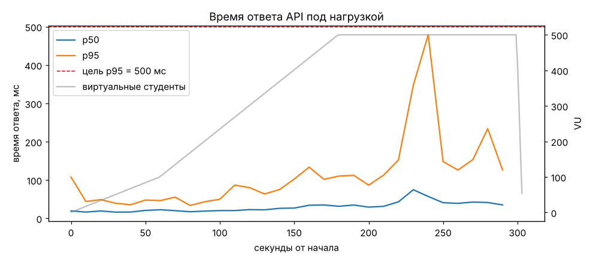
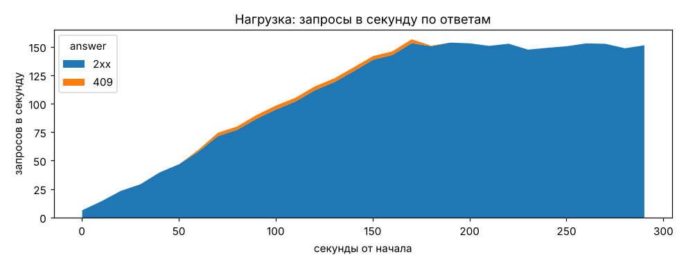

# Нагрузочный тест: «перемена»

Цель из SPEC 13: 500 виртуальных студентов за 5 минут заказывают обед в 6 слотов по 30 мест
и на ограниченные порции. Требования: p95 времени ответа < 500 мс, ошибок 5xx нет,
`booked_count <= capacity` у всех слотов и `available_portions >= 0` у всех блюд.

**Итог (12.10.2026): все цели выполнены.** p95 = 138 мс, 0 ответов 5xx, ни один слот и ни
одно блюдо не перепроданы.

## Сценарий

Файлы: `infra/k6/order_rush.js` (k6), `backend/scripts/load_setup.py` (данные),
`backend/scripts/load_check.py` (проверка базы после теста), `infra/k6/report.py` (графики).

1. `load_setup` создаёт отдельную столовую `load-<время>` с часом выдачи впереди: 6 слотов по
   10 минут, 30 мест в каждом, и три блюда (плов, самса, чай) по 60 порций. Создаёт 500
   студентов с подтверждённой почтой в группе без пар (подходят все слоты) и пишет их
   access-токены в `backend/load_users.json`.
2. k6 поднимает число студентов с 0 до 100 за 1 минуту, до 500 за следующие 2 минуты и
   держит 500 ещё 2 минуты. Каждый студент:
   - открывает меню (`GET /canteens/{id}/menu`), потом слоты (`GET /canteens/{id}/slots`);
   - через 0–2 с «выбора» один раз заказывает 1–2 порции случайного блюда
     (`POST /orders`): половина студентов берёт самый ранний свободный слот (давка за
     первый слот), остальные — случайный свободный;
   - дальше каждые 3–5 с обновляет меню и статус своего заказа (`GET /orders/{id}`), как
     открытая страница заказа.
3. Мест меньше, чем студентов (180 мест, 180 порций на 500 человек), поэтому большая часть
   заказов должна получить 409 (`slot_full` или `sold_out`). Ответ 201 или 409 у
   заказа считается правильным, любой 5xx — ошибкой теста.
4. `load_check` проверяет SQL-запросами: у каждого слота `booked_count <= capacity` и счётчик
   равен числу активных заказов; у каждого блюда `available_portions >= 0` и
   `план − остаток = продано`.

## Окружение

Честно: тест шёл не на сервере из фазы 12, а на одной машине разработки, вместе с базой и k6.

| | |
|---|---|
| Машина | 4 vCPU, 16 ГБ RAM, Linux |
| API | uvicorn 0.54, 4 процесса (`--workers 4`), FastAPI 0.143, SQLAlchemy 2.0, psycopg 3 |
| Пул БД | 10 + 10 соединений на процесс (`DB_POOL_SIZE`, `DB_MAX_OVERFLOW`) |
| База | PostgreSQL 16 в Docker, `max_connections = 100`; Redis 7 в Docker |
| Генератор | k6 0.54 на той же машине |

Ограничение частоты заказов (10 в минуту на пользователя) было включено, как в работе.

## Результаты

| Показатель | Значение | Цель |
|---|---:|---|
| Запросов всего | 33 039 (108 в секунду в среднем, ~150 в пике) | |
| Время ответа p50 / p95 / max | 30 / **138** / 913 мс | p95 < 500 мс ✔ |
| Ответов 5xx | **0** | 0 ✔ |
| Проверки k6 (`checks`) | 100 % (33 039 из 33 039) | |
| Заказов создано / отклонено 409 | 120 / 380 | |

По эндпоинтам:

| endpoint | requests | p50, ms | p95, ms | p99, ms | max, ms |
|---|---:|---:|---:|---:|---:|
| `GET /canteens/{id}/menu` | 24439 | 32 | 147 | 362 | 913 |
| `GET /canteens/{id}/slots` | 500 | 14 | 44 | 92 | 214 |
| `GET /orders/{id}` | 7600 | 24 | 117 | 306 | 691 |
| `POST /orders` | 500 | 28 | 83 | 132 | 171 |





Состояние базы после теста (`python -m scripts.load_check`):

```
slot   booked/capacity  orders
12:00      30/30       30
12:10      30/30       30
12:20      19/30       19
12:30      13/30       13
12:40      14/30       14
12:50      14/30       14
menu item  available/planned  sold
      470          0/60      60
      471          0/60      60
      472          0/60      60
orders placed: 120
OK: booked_count <= capacity, available_portions >= 0, counters match the orders
```

Два первых слота, за которые шла давка, заполнены ровно до 30. Все 180 порций проданы, ни
одной лишней: заказы закончились на порциях (в среднем 1,5 порции на заказ, поэтому 120
заказов), а не на местах. Счётчики слотов и порций совпали с заказами в базе. Так работает
атомарное `UPDATE ... WHERE остаток >= :qty RETURNING` (SPEC 5.3): проверка остатка и
списание идут одним запросом, и одновременные заказы не могут взять одно место дважды.

В одном 10-секундном окне (около 240-й секунды, 500 студентов) p95 поднялся до 480 мс:
это пик опросов меню одновременно с последними заказами на одной машине с k6 и базой. По
всему тесту p95 = 138 мс.

## Что нашёл тест и что исправлено

Первый прогон не прошёл: 19 ответов 500, а в конце теста запросы висели по 30 секунд.
В логах API — `QueuePool limit of size 10 overflow 20 reached, connection timed out` и
`sorry, too many clients already` от Postgres.

Причины:
1. Синхронные эндпоинты FastAPI выполняются в пуле из 40 потоков, а пул соединений с базой
   был 30. Под давкой все 40 потоков ждали соединение, а запросы, которые уже отработали,
   не могли вернуть своё соединение: закрытие сессии тоже ждёт свободный поток. Всё стояло
   до таймаута пула в 30 секунд.
2. 4 процесса × 30 соединений = 120, больше `max_connections = 100` у Postgres.

Исправление (`app/main.py`, `app/db.py`, `app/config.py`):
- размер пула вынесен в настройки `DB_POOL_SIZE` и `DB_MAX_OVERFLOW` (по умолчанию 10 + 10);
- пул потоков API ограничен тем же числом (20). Запрос больше не держит поток, пока ждёт
  соединение, которое нужно вернуть другому запросу;
- правило для продакшена: процессов × 20 должно быть меньше `max_connections`.

Тест `tests/test_db_pool.py` проверяет, что пул потоков равен пулу соединений.

## Как повторить

В Docker (Windows, macOS, Linux), при запущенном `docker compose up -d`:

```
make load-test
```

Без make (например, в PowerShell):

```
docker compose exec backend python -m scripts.load_setup
docker compose --profile load run --rm k6
docker compose exec backend python -m scripts.load_check
```

Итоги k6 сохраняются в `infra/k6/out/summary.json`. В dev-окружении backend работает в одном
процессе с `--reload`, поэтому цифры будут хуже, чем в таблице выше; для замеров запускайте
API в несколько процессов, как в продакшене.

Графики из CSV k6:

```
k6 run --out csv=k6.csv infra/k6/order_rush.js
python infra/k6/report.py k6.csv docs/load-test/k6
```

Токены живут 15 минут (`ACCESS_TOKEN_MINUTES`), поэтому k6 нужно запускать сразу после
`load_setup`. Поздно вечером, когда час выдачи не помещается в сегодняшний день,
`load_setup` создаёт слоты на завтра с 12:00. Нагрузочные столовые не мешают демо: каждый
запуск выключает предыдущие. Не запускайте тест на рабочей базе.
