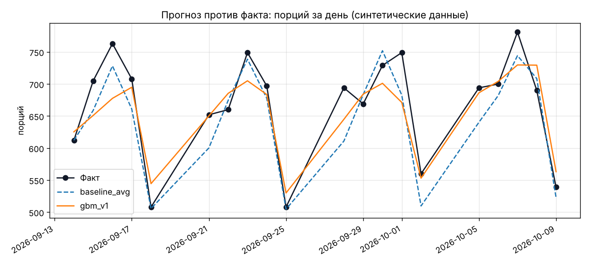
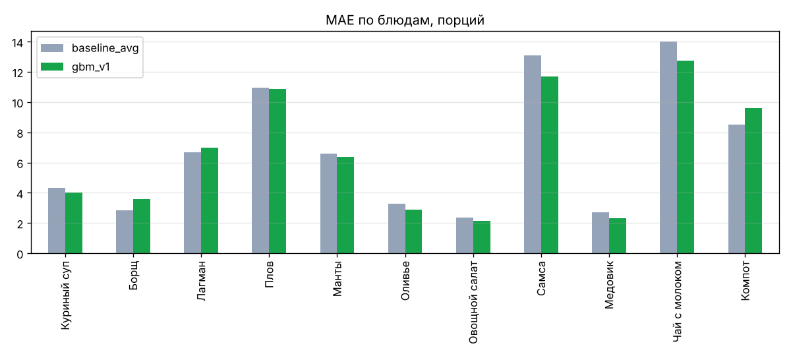

# Прогноз против факта

Столовая `main`, дни 2026-09-14 — 2026-10-09 (20 дней, 220 позиций меню). Данные синтетические (`ml/synthetic_history.py`).
Каждый день модели обучены только на днях до него (walk-forward).

| model | mae | mape | n |
|---|---|---|---|
| baseline_avg | 6.849 | 11.17 | 220 |
| gbm_v1 | 6.658 | 10.982 | 220 |

Точнее по MAE: **gbm_v1**.

## MAE по дням недели

| weekday | baseline_avg_mae | gbm_v1_mae |
|---|---|---|
| Пн | 7.392 | 6.065 |
| Вт | 8.653 | 8.384 |
| Ср | 6.892 | 6.822 |
| Чт | 7.33 | 8.127 |
| Пт | 3.977 | 3.891 |

